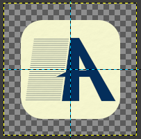

# Contributing to Axion Notes

Thanks for helping improve Axion Notes. Contributions are welcome for bug fixes, features, tests, documentation, translations, and accessibility improvements.

## Before You Start

- Search existing [issues](https://github.com/SolisWare/axion-notes/issues) before opening a new one.
- For a substantial feature or behaviour change, open an issue first so the approach can be discussed before implementation.
- Do not use public issues, discussions, or pull requests for security vulnerabilities. Follow the private reporting instructions in [SECURITY.md](SECURITY.md).

## Development Setup

### Prerequisites

- [Node.js](https://nodejs.org/) 22.12 or newer
- npm 10 or newer

### Clone and Install

```bash
git clone git@github.com:SolisWare/axion-notes.git
cd axion-notes
npm ci
```

### Run the App

```bash
npm run electron:dev
```

This starts the Vite web server and Electron desktop app. Changes in `electron/` require restarting the development process.

To work on the browser version only:

```bash
npm run start:web
```

## Tests and Builds

Run the relevant checks for the area you change:

```bash
npm run test:unit
npm run test:integration
npm run test:e2e
npm run build
```

Encryption fuzz testing is also available:

```bash
npm run test:fuzz
```

See [TESTING.md](TESTING.md) for the test layers, reports, and targeted commands.

## Code and Documentation

- Follow the existing TypeScript, React, Electron, and test conventions in nearby code.
- Keep changes focused; avoid unrelated formatting or refactoring in the same pull request.
- Add or update tests when behaviour changes or a bug is fixed.
- Update user-facing documentation and the changelog when a change affects users.
- English is the source locale. Change other locale files only when the contribution specifically concerns those translations.

## Pull Requests

1. Fork the repository and create a focused branch from `develop`.
2. Use a clear branch name, such as `fix/note-encryption-migration` or `feature/note-search`.
3. Make the change, run the relevant checks, and write clear commit messages.
4. Open the pull request against `develop`.
5. Explain what changed, why, how it was tested, and any follow-up work or limitations.

Pull requests require review and approval from the SolisWare team before merging.

## Translations

Thank you for helping make Axion Notes available to more people. English is the source locale. Partial translations are welcome, and missing strings fall back to English while translation coverage improves.

### Add a Translation

1. Create a branch in your fork, for example `translation/spanish`.
2. Copy `src/i18n/locales/en/en.json` to `src/i18n/locales/<lang-code>/<lang-code>.json`.
3. Translate values only. Keep JSON keys, nesting, punctuation, placeholders, and `{{variables}}` unchanged.
4. Add the language to `src/i18n/supported-languages.json`, for example:

   ```json
   {
     "code": "es",
     "label": "Spanish"
   }
   ```

   Use the English language name for `label`. The language picker gets its native display name from the app's internationalization data.

5. Open a pull request against `develop`.

### Translation Guidelines

- Do not translate product names such as Axion Notes or brand names such as SolisWare.
- Keep variables such as `{{count}}`, `{{name}}`, or other placeholder text exactly as written.
- Keep UI text short enough to fit buttons, menus, and settings labels.
- Prefer natural wording over literal translations.
- If a phrase is uncertain, leave it in English or explain the question in the pull request.

You can also improve existing translations, complete partial translations, or review translated strings for accuracy and tone.

## Project Structure

```text
axion-notes/
├── electron/          # Electron main process, preload, and menu
├── src/               # React renderer: components, pages, theme, and types
├── assets/            # App icons and installer assets
├── docs/              # Project documentation and README images
├── build/             # Generated compiled output; do not edit or commit
├── dist/              # Generated distribution packages; do not edit or commit
└── public/            # Static web assets
```

## Versioning and Release Builds

Version metadata is managed in `app-version-config.json`. After changing a release value, run:

```bash
npm run version-numbers
```

This updates `package.json`, `package-lock.json`, and the README version badge.

| Value | Type | Description |
| --- | --- | --- |
| `majorVersion` | `number` | Major version number; for example, `1` in `1.2.0`. |
| `minorVersion` | `number` | Minor version number; for example, `2` in `1.2.0`. |
| `patchVersion` | `number` | Patch version number; for example, `0` in `1.2.0`. |
| `preReleaseVersion` | `string` | Optional prerelease suffix; for example, `beta.1` produces `-beta.1`. |
| `buildVersion` | `string` | Optional build suffix; for example, `123` produces `-b123`. |
| `releaseCodename` | `string` | Optional label for the app About dialog; it does not affect the package version. |

`GITHUB_RUN_NUMBER` takes precedence over `buildVersion` when creating a build version.

Build the app before creating a distribution package:

```bash
npm run build
npm run dist-mac-arm64
npm run dist-mac-x64
npm run dist-windows-x64
npm run dist-windows-x86
```

Distribution commands do not build the app themselves. Their output is written to `dist/`.

## App Icons

Keep visible icon artwork centered with even padding; do not fill the entire canvas. Use the SVG as the primary source where possible, and generate raster assets only where required for favicons, manifests, installers, or platform packaging.



| Canvas size | Icon artwork size | Total padding | Padding per side | Artwork ratio |
| --- | --- | --- | --- | --- |
| `192 x 192` | `143 x 143` | `49 px` | `24.5 px` | `74.5%` |
| `512 x 512` | `433 x 433` | `79 px` | `39.5 px` | `84.6%` |
| `1024 x 1024` | `865 x 865` | `159 px` | `79.5 px` | `84.5%` |

For the larger icons, use an artwork-to-canvas ratio of about `0.845`:

```text
artwork size = canvas size * 0.845
padding per side = (canvas size - artwork size) / 2
```

Generate `.icns` files for macOS and `.ico` files for Windows from the padded `1024 x 1024` source artwork. Keep generated assets in `public/` or `assets/`, according to how the build consumes them.
