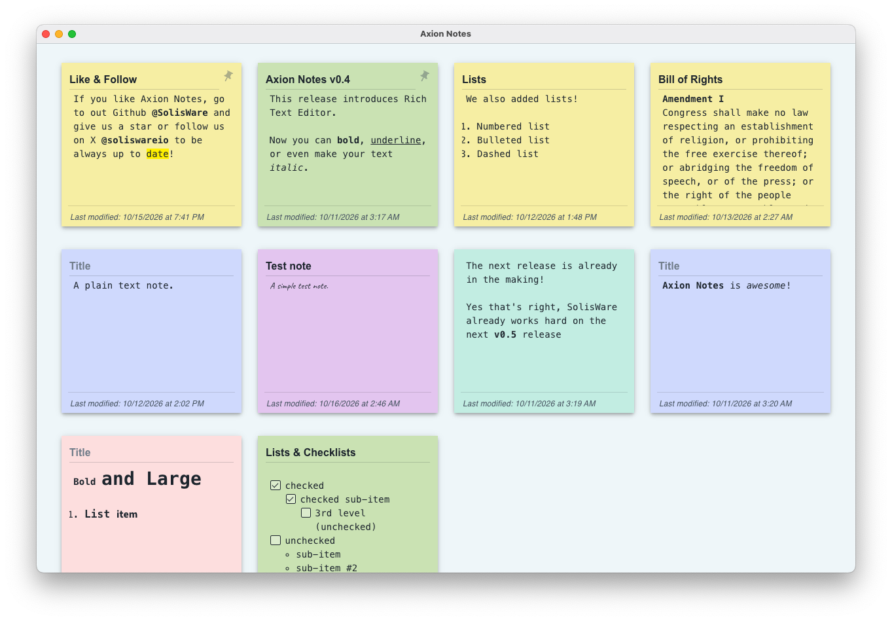
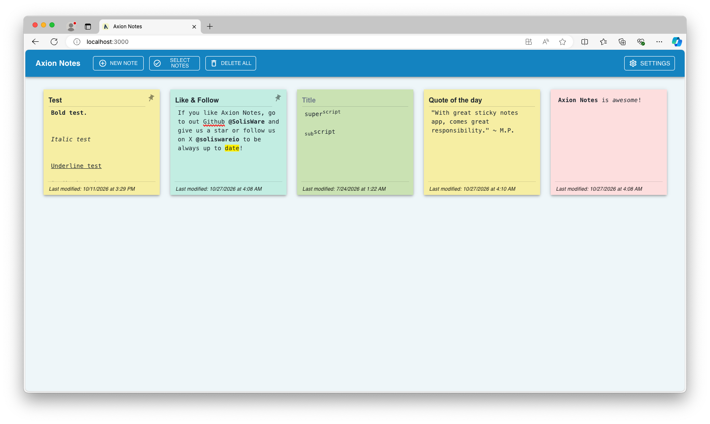
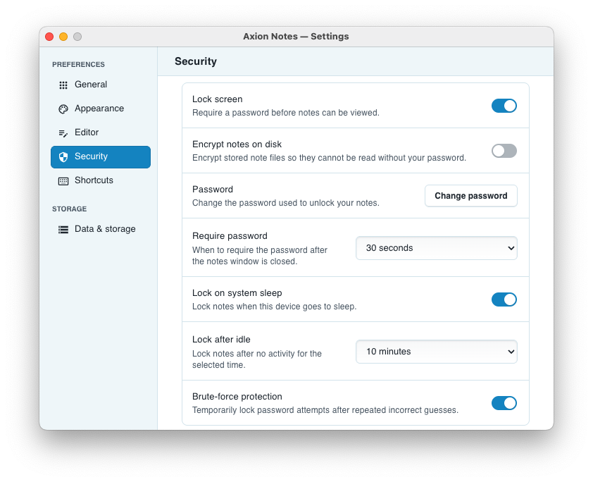

# Axion Notes - Sticky Notes App for macOS, Windows, and Web


Axion Notes is an open source sticky notes app for macOS, Windows, and the web, built by SolisWare. It combines a React web app with an Electron desktop client so you can create, format, organize, and save digital sticky notes locally on your device. The desktop app also supports a lock screen and optional local encryption for notes.

### Early release notice
> SolisWare Axion Notes is currently pre-1.0 software. Features, storage formats, settings, and app behavior may change between releases, and backward compatibility is not guaranteed until a stable 1.0 release.
>
> When updating between early releases, locally stored notes or settings may not always migrate cleanly. Please keep a backup of anything important before installing a new version.

## App Overview

Axion Notes is a simple, flexible workspace for capturing ideas before they slip away. Use it as a desktop sticky notes app on macOS or Windows, or run it as a browser-based notes app with the same familiar sticky-note workflow.

The app is designed for quick personal notes, reminders, lightweight planning, and visual organization. Notes and settings are stored locally, so Axion Notes works well for users who want a fast private notes board without needing an online account.

Key features:
- Color-coded notes
- Grid and list layouts
- Foldable and pinned notes
- Drag-and-drop reordering
- Rich-text formatting
- Checklists and list formatting
- Note selection mode
- Separate note windows
- Smart sorting
- Light, dark, and system themes
- Local storage and auto-save
- Desktop lock screen and optional local note encryption
- Desktop and web apps

### Desktop App


### Web App


## Features

### Organize Notes
Use note colors, sorting, pinning, duplication, batch selection, and drag-and-drop reordering to shape your notes board around the way you think. The desktop app also includes a list layout for browsing notes as a compact vertical stack with folded and expanded notes.

### Edit Notes
Notes auto-save as you type and support rich-text formatting, including bold, italic, underline, strikethrough, font face, font size, bullet lists, dashed lists, numbered lists, and checklists. Formatting is available through menus, keyboard shortcuts, and note formatting toolbars.

### Focus On A Note
Desktop users can open a note in its own dedicated window with live synchronization back to the main notes view. Browser users can open a focused full-note dialog instead, keeping the web app workflow close to the desktop experience.

### Customize The Workspace
Axion Notes includes settings for theme, note size, title and content fonts, default font sizes, default note color, title visibility, footer visibility, sorting, editor mode, and layout. The desktop app also supports always-on-top mode.

### Security & Privacy (Desktop)
Desktop users can protect their notes with a lock screen and configure a password to unlock them. Optional local encryption protects note data at rest, while Secure Lock clears decrypted notes from memory when you lock the app. By default, Axion Notes windows are protected from screen capture where supported while Lock screen is enabled; this can be changed in Security settings when needed. You can also configure the app to lock when the system locks, sleeps, or has been idle.



<!-- Add a lock screen screenshot here: docs/images/lock-screen.png -->

### Language Support
Axion Notes can choose supported language, date, and time defaults from the OS or browser on first launch, then keeps those settings until you change them. English is the source locale, with Estonian, Polish, and Spanish translations currently available.

### Shortcuts
Common note, selection, and formatting actions are available from the keyboard. The Shortcuts settings page groups commands by General, Note selection, Text formatting, and Lists so you can quickly check what is available.

### Suggested Next Features
Some useful features being considered for future releases include note search, archiving, deleted-note recovery, import/export backups, note templates, keyboard navigation between notes, and reminders.

## Getting Started

### Download & Install
 
Download the latest prebuilt release for your platform from the [Releases](https://github.com/SolisWare/axion-notes/releases) page.
 
> **macOS users:** If you see a *"Axion Notes is damaged and can't be opened"* warning after downloading, this is macOS Gatekeeper blocking the app because it is not yet signed with an Apple Developer certificate. The app itself is fine. Run the following command in Terminal to fix it:
> ```bash
> xattr -cr "/Applications/Axion Notes.app"
> ```
>
> **Windows users:** If you see a *"Windows protected your PC"* warning after downloading, this is Microsoft Defender SmartScreen blocking the installer because it is new or not yet widely recognized. The app itself is fine. Click **More info**, then click **Run anyway** to continue the installation.

### Supported Platforms

| Platform | App type | Notes |
| --- | --- | --- |
| macOS | Electron desktop app | Apple Silicon and Intel builds |
| Windows | Electron desktop app | 64-bit and 32-bit installers |
| Web | React web app | Runs in a modern browser with local storage |

## Contributing
Want to help? See [CONTRIBUTING.md](CONTRIBUTING.md) for issues, pull requests, translations, development setup, tests, release builds, and app-icon guidance.

## License
Axion Notes is open source software licensed under the [MIT License](LICENSE.txt).
 
You are free to use, modify, and distribute this software. Attribution is not required but is greatly appreciated — if you use our code in your project, a mention or a link back to this repository means a lot to us.

## FAQ

### What is Axion Notes?
Axion Notes is an open source digital sticky notes app for desktop and web. It is designed for quick notes, reminders, lightweight planning, and visual organization.

See more: [App Overview](#app-overview).

### Does Axion Notes work offline?
Yes. Axion Notes stores notes locally on your device, so the desktop app and browser app can keep your notes without requiring an online account.

### Where are my notes stored?
Axion Notes stores notes locally on the device or browser where you create them. The app does not require an account or remote service to save your notes.

### Can I sync notes between devices?
Not currently. Desktop and web notes are stored locally for now, so notes do not automatically sync between devices or browsers.

### Are my notes encrypted?
Optional local encryption is available in the desktop app. When enabled, notes are encrypted on disk and require the password you configured to unlock them. Encryption is not available in the web app. As this is pre-1.0 software, keep a backup of important notes before updating or changing security settings.

### Can I use plain text instead of rich text?
Yes. Axion Notes includes a Rich Text Editor setting. Turning it off uses the Plain Text Editor instead. Existing formatted notes keep their rich content unless you edit them while the Plain Text Editor is active, which converts that note to plain text.

### Can I open a note separately?
Yes. The desktop app can open notes in dedicated note windows, and the web app uses a focused note dialog. Edits stay synchronized with the main note grid or list.

### Which platforms does Axion Notes support?
Axion Notes supports macOS, Windows, and web browsers. The desktop version is built with Electron, and the web version is built with React.

See more: [Supported Platforms](#supported-platforms).

### Why does macOS or Windows warn me before opening Axion Notes?
Axion Notes is not yet signed with an Apple Developer certificate or widely recognized by Microsoft Defender SmartScreen. The app itself is fine, but your operating system may show a warning before opening a new unsigned app.

See more: [Download & Install](#download--install).

### Is Axion Notes available in other languages?
Axion Notes is being built with language support so the app can grow beyond English over time. English is the source locale, with Estonian, Polish, and Spanish translations currently available. Additional languages can be added through community translation contributions. If you want Axion Notes in your language, we would love your help translating the app and improving its language support.

See more: [Contributing Translations](CONTRIBUTING.md#translations).

### Will Axion Notes support Linux or other platforms?
Linux support is planned for the future. Axion Notes is being built with cross-platform technologies, and we want to expand platform support carefully as the app matures. Until then, we recommend using the Axion Notes web app on platforms without a dedicated desktop build.

See more: [Supported Platforms](#supported-platforms).
